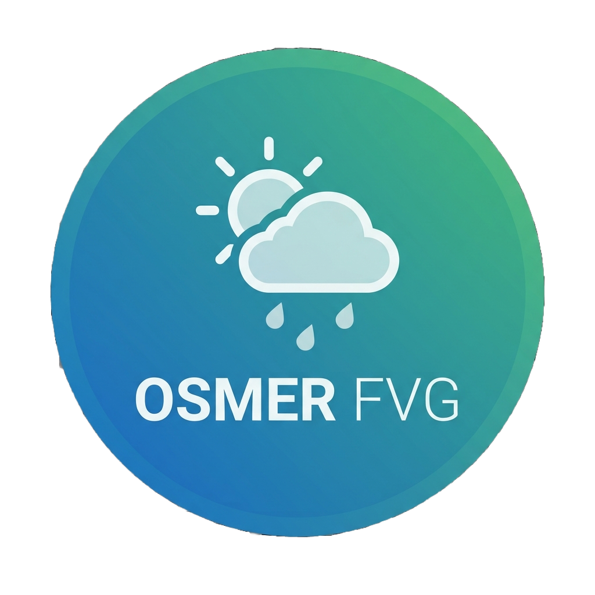

# OSMER FVG - Home Assistant Integration

  

**OSMER FVG** è un'integrazione custom per **Home Assistant** che consente di monitorare i dati in tempo reale delle stazioni meteorologiche dell'**OSMER (Osservatorio Meteorologico Regionale del Friuli Venezia Giulia)**, attingendo direttamente dai dati pubblici della **Protezione Civile FVG**.

L'integrazione è totalmente gratuita e **non richiede account né API key**.

---

## 🌟 Funzionalità principali

- 🌤️ **Entità Meteo Nativa (`weather`)**: Compatibilità immediata con le card Meteo di Home Assistant (temperatura, umidità, stato precipitazioni).
- 📊 **Sensori Avanzati (`sensor`)**: Creazione automatica di entità per temperatura, umidità, precipitazioni accumulate (supporto alle statistiche a lungo termine HA) e livelli idrometrici.
- 📍 **Ricerca Stazione Intelligente**:
  - Selezione diretta da elenco completo con indicatore dei sensori attivi.
  - Ricerca tramite indirizzo con calcolo automatico delle stazioni più vicine in ordine di distanza.
- ⚡ **Ottimizzata & Asincrona**: Chiamate alle API in parallelo tramite `asyncio` per aggiornamenti rapidi e leggeri.
- 🛠️ **Diagnostica integrata**: Download dello stato di salute dell'integrazione direttamente dalla dashboard di Home Assistant.

---

## 🚀 Installazione

### Tramite HACS (Consigliata)

1. Apri **Home Assistant** e accedi a **HACS → Integrazioni**.
2. Clicca sui **tre puntini** in alto a destra e seleziona **Repository personalizzate**.
3. Inserisci l'URL della repository: `https://github.com/spoggesi/ha-osmer-fvg`
4. Seleziona la categoria **Integrazione** e clicca **Aggiungi**.
5. Cerca **OSMER FVG**, clicca **Scarica** e infine riavvia Home Assistant.

### Installazione Manuale

1. Scarica l'ultima release o clona il repository.
2. Copia la cartella `custom_components/osmer_fvg` all'interno della directory `config/custom_components/` della tua istanza di Home Assistant.
3. Riavvia Home Assistant.

---

## ⚙️ Configurazione

Dopo il riavvio:

1. Vai su **Impostazioni → Dispositivi e servizi → Aggiungi integrazione**.
2. Cerca **OSMER FVG**.
3. Scegli se selezionare la stazione manualmente da elenco oppure tramite ricerca per indirizzo.
4. Seleziona i sensori che desideri monitorare e completa la procedura guidata.

---

## 📱 Piattaforme ed Entità create

Ogni stazione configurata crea un dispositivo dedicato in Home Assistant che raggruppa le seguenti entità:

### Entità Meteo (`weather`)
| Entità | Stato / Attributi |
|---|---|
| `weather.osmer_<station_id>` | Temperatura attuale, umidità e condizione meteo |

### Sensori (`sensor`)
| Categoria | Sensore | Unità | Note |
|---|---|---|---|
| **Meteo Base** | Temperatura aria | °C | Sensore `measurement` |
| | Umidità relativa | % | Sensore `measurement` |
| **Precipitazioni** | Pioggia / Pluviometro | mm | Supporto `total_increasing` per statistiche |
| | Pioggia oraria / 24h / 48h | mm | Accumuli storici fino a 48 ore |
| **Idrologia** | Livello idrometrico | m | Monitoraggio fiumi e corsi d'acqua |
| **Diagnostica** | Stato carica / alimentazione | mA / sts | Diagnostica della stazione remota |

---

## 🌐 Origine dati e Requisiti

- **Origine Dati**: Dati pubblici erogati dalla [Protezione Civile FVG - OSMER](https://monitor.protezionecivile.fvg.it).
- **Requisiti**: Home Assistant >= 2024.1.0 e connessione internet attiva.

---

## 🤝 Supporto e Contributi

Se riscontri problemi o hai idee per nuove funzionalità:
- 🐛 [Segnala un bug o richiedi una funzionalità](https://github.com/spoggesi/ha-osmer-fvg/issues)
- 🔀 Le *Pull Request* sono sempre le benvenute!

---

## 📄 Licenza

Questo progetto è rilasciato sotto Licenza **MIT**. Consulta il file `LICENSE` per ulteriori dettagli.